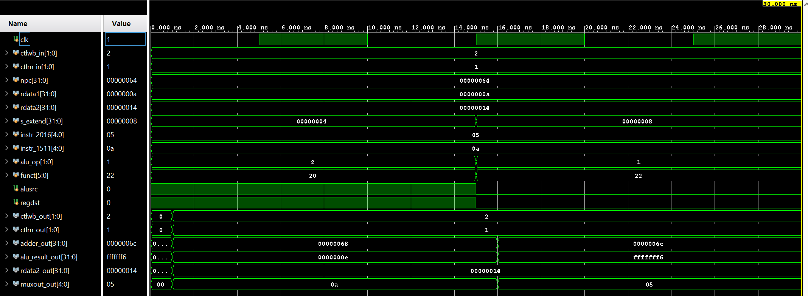
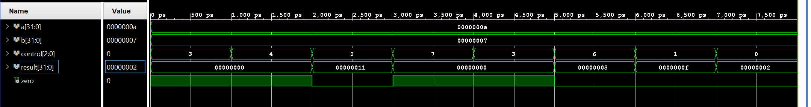

### Execute Stage (MIPS Pipeline)

#### Design Scope and Assumptions
*   **In scope:** Implementation of the Execute Stage of a MIPS pipeline, which combines an `adder`, `bottom_mux` (5-bit), `alu_control`, `alu`, `top_mux` (32-bit), and `ex_mem` pipeline latch into a top-level module. 
*   **Out of scope:** The Instruction Fetch, Instruction Decode, Memory, and Write Back stages of the pipeline are intentionally excluded from this repository.
*   **Assumptions:** The design utilizes 32-bit data pathways for ALU operations and memory addressing, and 5-bit pathways for register destination selection. The ALU expects a 3-bit control signal mapped from a 6-bit `funct` and 2-bit `alu_op` input.
*   **Limitations:** The `alu_control` explicitly handles `Rtype` (2'b10), `lwsw` (2'b00), and `Itype` (2'b01) instructions. Unknown opcodes fall back to an `ALUx` (3'b011) error state. 

#### Requirements
| Requirement | Description | Verification Method |
| ------ | ------ | ------ |
| REQ-01 | The ALU shall perform ADD, SUB, AND, OR, and SLT operations using bit-wise logic and raise a zero flag when the result is zero. | Testbench simulation using `alutb.v`. |
| REQ-02 | The ALU Control unit shall output a 3-bit control signal by correctly evaluating the incoming `funct` field for R-type instructions, or overriding it for I-type and memory instructions. | Testbench simulation using `alu_controltb.v`. |
| REQ-03 | The EX/MEM latch shall capture inputs from the execute modules, apply a delay, and output them to the MEM/WB and FETCH stages. | Top-level system simulation using `executetb.v`. |

#### Architecture
##### Timing or Behavioral Summary




#### Implementation
##### Source Code
| File | Description |
| ------ | ------ |
| [`execute.v`](https://github.com/ET-struct/Execute/blob/main/execute.v) | Top-level execution stage module combining the ALU, multiplexers, adder, ALU control, and latch. |
| [`alu.v`](https://github.com/ET-struct/Execute/blob/main/alu.v) | 32-bit ALU executing addition, subtraction, bit-wise logic, and comparisons. |
| [`alu_control.v`](https://github.com/ET-struct/Execute/blob/main/alu_control.v) | Control logic that decodes instruction fields into a 3-bit ALU operation selector. |
| [`adder3.v`](https://github.com/ET-struct/Execute/blob/main/adder3.v) | 32-bit adder module used for branch target calculations (the module definition inside is simply named `adder`). |
| [`top_mux.v`](https://github.com/ET-struct/Execute/blob/main/top_mux.v) | 32-bit 2-to-1 multiplexer to select the ALU's second operand using `ALUSrc`. |
| [`bottom_mux.v`](https://github.com/ET-struct/Execute/blob/main/bottom_mux.v) | 5-bit 2-to-1 multiplexer to select the destination register using `regdst`. |
| [`ex_mem.v`](https://github.com/ET-struct/Execute/blob/main/ex_mem.v) | Pipeline latch boundary that initializes all values to `0` and stores state between Execute and Memory stages. |
| [`executetb.v`](https://github.com/ET-struct/Execute/blob/main/executetb.v) | System-level verification testbench that toggles control signals and operands for the integrated execute stage. |

##### Implementation Notes
*   **SLT Implementation:** The ALU implements "Set on Less Than" (`ALUslt`) by calculating a `sign_mismatch` using an XOR operation (`a[31]^b[31]`). It uses a ternary operator (`result = a < b ? 1 - sign_mismatch : 0 + sign_mismatch`) to return the result.
*   **Logical Operations Fix:** The ALU uses bit-wise operators (`&` and `|`) for AND/OR operations rather than logical equivalents.
*   **Default Safe States:** The `alu.v` module returns `32'b0` as a default to prevent undefined states if the 3-bit control signal is unrecognized.
*   **Update Delays:** The `ex_mem.v` latch explicitly includes a `#1` hardware delay inside its `always@*` block to simulate pipeline update timing.

#### Verification
##### Verification Strategy
The design is verified using **behavioral simulation** via dedicated testbenches for individual modules and the integrated stage.
Verification covers:
*   Arithmetic and logical operation edge cases in the ALU via `alutb.v` (testing values like `a = 10`, `b = 7` across different control signals).
*   Control signal mapping verification in `alu_controltb.v` simulating R-Type, I-Type, and memory operations.
*   Integrated dataflow and sequential clock synchronization in the top-level `execute` module via `executetb.v`.

##### Testbench and Waveform


The primary integrated testbench source is [`executetb.v`](https://github.com/ET-struct/Execute/blob/main/executetb.v).
The supporting testbenches are | [`alu_controltb.v`](https://github.com/ET-struct/Execute/blob/main/alu_controltb.v) and | [`alutb.v`](https://github.com/ET-struct/Execute/blob/main/alutb.v).

##### Results
| Test Case | Expected Result | Observed Result | Status |
| ------ | ------ | ------ | ------ |
| TC-01 — ALU Operations | `alu` correctly outputs arithmetic/logical results and `zero` flag based on the 3-bit control. | `alu` outputs correct results | Pass |
| TC-02 — ALU Control | `alu_control` correctly overrides to `ALUadd` for `lwsw` and decodes `funct` fields for R-Type operations. | `alu` correctly overrides and decodes | Pass |
| TC-03 — Stage Integration | `execute` successfully routes multiplexed operands to the ALU and latches outputs into `ex_mem`. | execute successfully routes muxed operands and latches outputs | Pass |

#### Reproduction Instructions
##### Tools and Versions
*   **Simulator / synthesis tool:** Xilinx Vivado or Icarus Verilog (due to `` `timescale 1ns / 1ps`` usage).
*   **Language / standard:** Verilog.
*   **Operating system:** [macOS, Windows, Linux, or other]
*   **Additional dependencies:** None.

##### Build and Run
```bash
# To compile using Icarus Verilog:
iverilog -o execute_sim execute.v alu.v alu_control.v adder3.v top_mux.v bottom_mux.v ex_mem.v executetb.v

# To execute the compiled simulation:
vvp execute_sim
```
##### Expected Output
```plaintext
# Example monitor output from alu_controltb.v
ALUOp = 00	funct = 100000	select = 010
ALUOp = 01	funct = 100000	select = 110
```
##### Repository Organization
```plaintext
.
├── README.md
├── images/
│   ├── executetb_timing_diagram.png
│   ├── alu_contoltb_timing_diagram.png
│   └── alutb_timing_diagram.png
├── adder3.v
├── alu.v
├── alu_control.v
├── bottom_mux.v
├── top_mux.v
├── ex_mem.v
├── execute.v
├── alutb.v
├── alu_controltb.v
└── executetb.v
```
## Known Issues and Future Improvements

- **Missing Shift-Left-2 for Branch Targets:** In `execute.v`, the branch target adder (`adder3`) directly adds the `npc` and `s_extend` signals. In a standard MIPS architecture, the sign-extended immediate must be shifted left by 2 bits (multiplied by 4) before being added to the PC to ensure the branch target is properly word-aligned. A shift-left-2 module or continuous assignment needs to be inserted before `adder_in2`.
- **Pipeline Latch Clocking Mismatch:** The `ex_mem.v` pipeline latch currently uses an asynchronous `always@*` block with a simulated `#1` delay to update its values. For hardware synthesis, pipeline latches must be strictly synchronous (e.g., `always @(posedge clk)`). 
- **Unconnected/Undeclared Clock Port:** There is a structural mismatch between the top-level module and the latch. `execute.v` attempts to map a clock signal to the latch using `.clk(clk)`, but the `ex_mem.v` module's port list does not actually declare a `clk` input. This will likely cause a port-mapping error during compilation or synthesis.
- **Future Extension — Forwarding Unit:** Because this execute stage is part of a larger pipelined processor, it will eventually suffer from Read-After-Write (RAW) data hazards. A realistic future improvement is integrating a Forwarding (Bypass) Unit into `execute.v` to intercept the ALU inputs and feed data directly from the EX/MEM or MEM/WB latches when data dependencies are detected.
- **Future Extension — Expanded Instruction Set:** The `alu_control` and `alu` currently only support a baseline subset of instructions (ADD, SUB, AND, OR, SLT, lw/sw). The stage should be extended to support immediate arithmetic (e.g., ADDI, ANDI), bitwise shifts (SLL, SRL), and unsigned comparisons.
